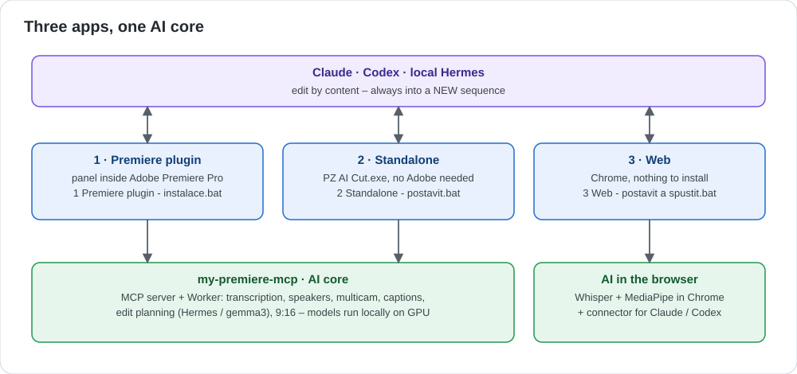
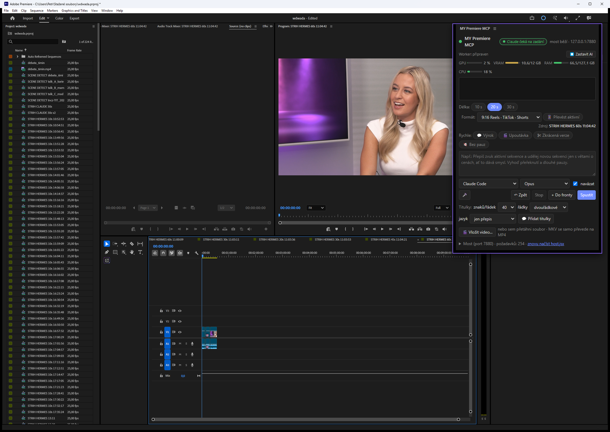
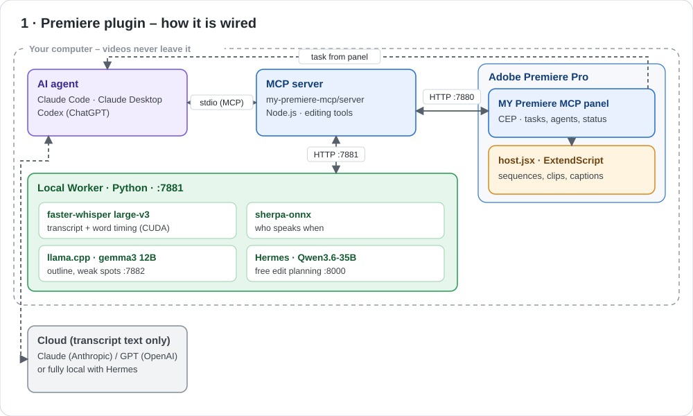
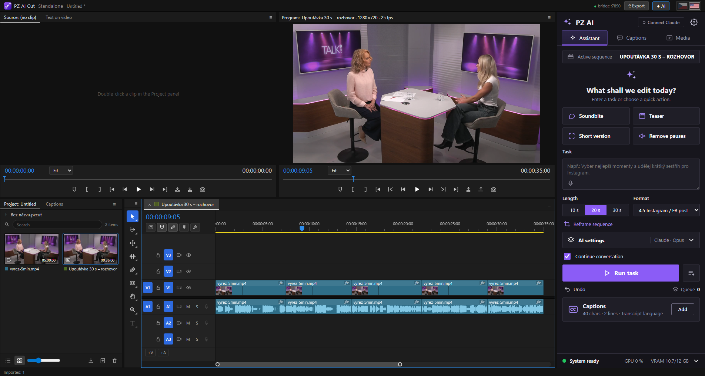
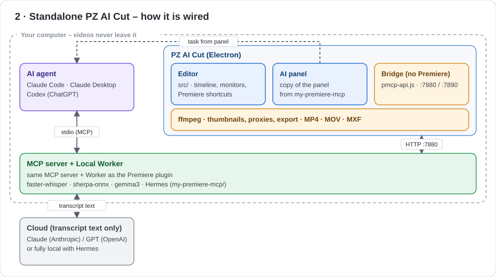
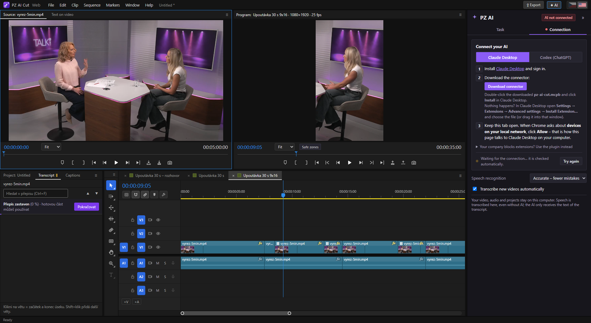
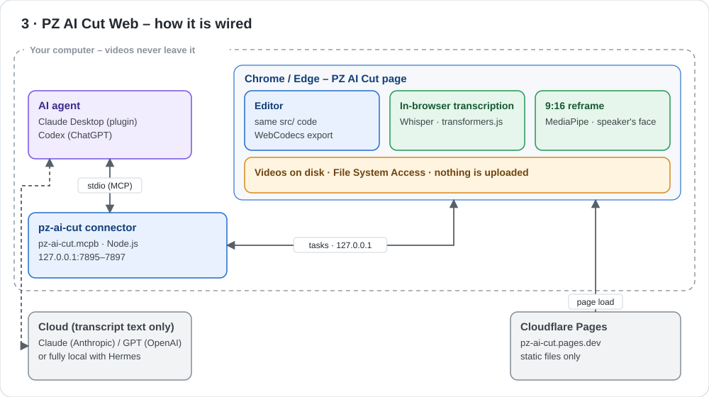

<p align="right">
  <a href="README.md"> Čeština</a>
  &nbsp;·&nbsp;
  <a href="README.en.md"> <b>English</b></a>
</p>

# AI EDIT for all – AI video editing three ways

One repository, three apps. Claude, Codex or the local Hermes model edit video **by what is being said**:
they pick the best soundbites, assemble a teaser or a short version, add captions and reframe to 9:16 for social media.
The result is always a **new sequence** – the original stays untouched. Videos never leave your computer; the AI only
receives the transcript text.

| | What it is | For whom |
|---|---|---|
| **1 · Premiere plugin** (MY Premiere MCP) | a panel and AI tools inside **Adobe Premiere Pro**: transcription, content-based editing, teasers, speaker-based multicam, captions and translation, Auto Reframe 9:16 | Premiere users |
| **2 · Standalone** (PZ AI Cut) | a standalone Windows editor that works like Premiere (same shortcuts and layout) with an AI panel – **no Adobe needed** | anyone without Premiere |
| **3 · Web** (PZ AI Cut Web) | the same editor in Chrome/Edge, nothing to install, transcription runs in the browser; AI via Claude Desktop or Codex | anyone, right now |



## Quick start (Windows)

```powershell
git clone https://github.com/petroza/AI-EDIT-for-all-.git
```

Then double-click **`START.bat`** in the folder (launcher menu), or one of the three files below directly.
The finished web version also runs online at **https://pz-ai-cut.pages.dev**; the finished portable app is in
**Releases** (`PZ-AI-Cut-portable.zip` – unzip next to `START.bat`).

> The app UI and AI panel are available in Czech and English (flag switch in the top right corner).
> The installer scripts and file names are in Czech: *instalace* = install, *postavit* = build, *spustit* = run.

---

## 1 · Premiere plugin – `1 Premiere plugin - instalace.bat`



The **MY Premiere MCP** panel in Premiere (Window › Extensions): local AI status (GPU, VRAM), length and format of the
result, quick actions (Soundbite, Teaser, Short version, Remove pauses), a free-text task, agent choice (Claude Code,
Codex, Hermes), captions and 9:16 reframing. The agent carries out the task directly in the open project.

**What gets installed** (all into the cloned `my-premiere-mcp\` folder, no admin rights):

| What | Where / from | Size |
|---|---|---|
| Node.js LTS, Python 3.11 – only if missing | winget | ~100 MB |
| npm and pip packages (faster-whisper, CUDA libraries, sherpa-onnx, OpenCV…) | `node_modules\`, `.venv\` | ~1.5 GB |
| Whisper large-v3 – transcription with word timing | `models\` (Hugging Face) | 3 GB |
| diarization – who speaks when | `models\diarization` | 40 MB |
| gemma3 12B + vision model + llama.cpp – outline, weak spots | `models\llm`, `tools\llama.cpp` | ~10 GB |
| **Hermes** (Qwen3.6-35B) – free edit planning, optional (asked) | `models\hermes` | ~23 GB |
| Premiere panel | link `%APPDATA%\Adobe\CEP\extensions\com.pz.premieremcp`, `PlayerDebugMode` in `HKCU\Software\Adobe\CSXS.*` | – |
| `premiere` MCP server | registered in Claude Code, Claude Desktop and Codex | – |

Requirements: Windows 10/11, Adobe Premiere Pro, ~15 GB of disk space (+23 GB with Hermes), internet. An NVIDIA GPU
makes transcription much faster; Hermes needs ~12 GB VRAM. After installing, restart Premiere →
**Window › Extensions › MY Premiere MCP** and start a new Claude session.



---

## 2 · Standalone – `2 Standalone - postavit.bat`



**PZ AI Cut** – a Windows editor without Adobe: Source / Program / Project / Timeline like Premiere, the same shortcuts
(J/K/L, I/O, C, Q/W…), transitions, captions, export to MP4 · MOV (ProRes) · MXF (XDCAM for broadcast), face-following
9:16 reframing. The AI panel on the right is the same as in Premiere.

**What gets installed:** `npm install` downloads Electron (~100 MB) into `pz-ai-cut\node_modules`, the script builds a
portable app into the `PZ AI Cut\` folder (`PZ AI Cut.exe`, nothing is written to the system). Settings and auto-saves
live in `%APPDATA%\TN_strihatoko`. Requires Node.js 18+ and ffmpeg (bundled with MY Premiere MCP, otherwise
`winget install Gyan.FFmpeg`).

**AI in the standalone app:** the AI panel uses MY Premiere MCP (transcription, Hermes, Claude) – run step 1 first
(you don't need Premiere for that). The app finds it automatically: `my-premiere-mcp\` next to it in this repository,
`%APPDATA%\MYpremiereMCP\root.txt`, the `MYPREMIEREMCP_ROOT` variable, or `pz-ai-cut\config.json` → `aiRoot`.
Without it, editing works but the AI panel does not.



---

## 3 · Web – `3 Web - postavit a spustit.bat`



The same editor in the browser (pictured: a sequence reframed to 9:16 and the AI connection guide). Videos are read
straight from disk, nothing is uploaded; speech is transcribed in the browser (Whisper, the ~1 GB model downloads once).

**What gets installed:** nothing – the script only builds `pz-ai-cut\web\dist` and serves it at
**http://127.0.0.1:8791/** (requires Node.js 18+, Chrome or Edge). For AI, download the connector from the page's
AI panel:

- **Claude Desktop** – the `pz-ai-cut.mcpb` extension (double-click → Install), or the plugin
  `Plugin pz-ai-cut\pz-ai-cut-plugin.zip` (Customize › Plugins › Add › Upload plugin; works in Cowork and the Code tab),
- **Codex (ChatGPT)** – one command from the AI panel.

Chrome asks once about access to devices on your local network – click **Allow** (the page talks to the connector
on 127.0.0.1). To host it yourself, upload `web\dist` as static files (e.g. Cloudflare Pages).



---

## Repository layout

| Folder | Contents |
|---|---|
| `my-premiere-mcp\` | MY Premiere MCP: `panel\` (Premiere CEP panel), `server\` (MCP server, Node), `worker\` (Python: Whisper, diarization, analysis), `INSTALL_SMALL\` (online install), `INSTALL\` (main installer), `PLUGIN CLAUDE\` (Claude plugin), `youtuber\` (After Effects episode versions). Docs (Czech): `my-premiere-mcp\README.md`, AI instructions `CLAUDE.md` |
| `pz-ai-cut\` | PZ AI Cut: `src\` (editor core and UI), `web\` (web version, bundler-free build), `connector\` (MCP connector for the web), `tools\` (`pack-portable.js`, faces, AI panel sync), `test\`, `team\` (development notes) |
| `Plugin pz-ai-cut\` | ready-made Claude plugin for the web version |
| `docs\` | images and diagrams (`python docs\make_diagrams.py` regenerates them) |

Manually (without .bat): `cd pz-ai-cut` → `npm install` → `npm start` (from source) / `npm run pack` (portable) /
`npm run web:serve` (web) / `npm test` (tests).
MY Premiere MCP manually: `powershell -ExecutionPolicy Bypass -File my-premiere-mcp\INSTALL_SMALL\install-online.ps1`
(options `-Hermes`, `-NoLocalLLM`, `-SkipModels`, `-Target <folder>`).

## For the maintainer
`Aktualizovat GitHub.bat` pulls the latest commits from the development folders (`O:\TN_strihatko`,
`O:\ADOBEPREMIERESTRIH`) into `pz-ai-cut\` and `my-premiere-mcp\` and pushes them here. Uncommitted changes are not
included.
